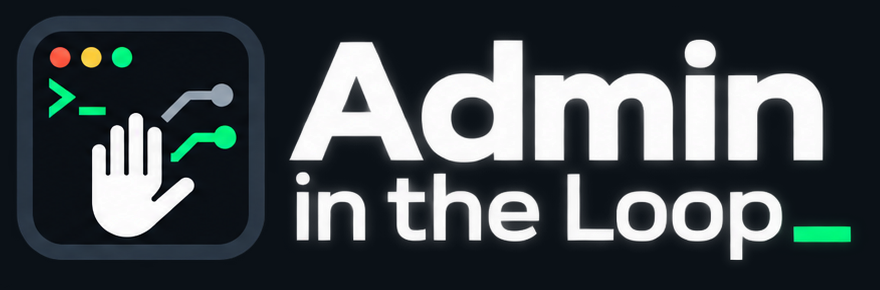

# Admin in the Loop

<picture>
  <source media="(prefers-color-scheme: dark)" srcset="doc/assets/branding/admin-in-the-loop-lockup-dark.png">
  <source media="(prefers-color-scheme: light)" srcset="doc/assets/branding/admin-in-the-loop-lockup-light.png">
  
</picture>

**AI assists, Admin decides.**

Admin in the Loop vermittelt zwischen AI-Vorschlägen und einem vom Menschen
bedienten Terminal. Die AI stellt Command-Vorschläge bereit; der Admin prüft und
genehmigt den exakten Text vor der Übergabe ans Terminal. Terminalausgabe wird
separat ausgewählt, geprüft und erst nach einer weiteren Freigabe an die AI
weitergegeben. Das Terminal bleibt unabhängig manuell bedienbar.

## Früher Entwicklungsstand

**v0.0.1 ist in Vorbereitung, noch nicht veröffentlicht.** Die Anwendung ist ein
früher MVP, keine Abnahme für kritische Infrastruktur. Die Bezeichnungen
„Konzept V0.7“ und „MVP 0.8“ in vorhandenen Dokumenten sind interne historische
Stände, keine veröffentlichten Release-Versionen.

Der [Testbericht vom 30. September 2026](tests/MVP_0.8_TEST_REPORT.md) dokumentiert
damalige Linux-/Ubuntu-Prüfungen. Er belegt keine aktuelle native macOS- oder
Debian-Desktop-Abnahme und keinen echten ChatGPT-/OpenAI-Round-Trip. Eine lokale
Bereitschaftsmeldung ist kein Nachweis, dass der gewünschte AI-Chat verbunden ist.

## Sicherheitsmodell in Kürze

- **Zwei getrennte Freigaben:** Command ins Terminal und ausgewählten Output an
  die AI. Ein eingegangener Vorschlag bedeutet nicht, dass er ausgeführt wurde.
- **Gebundener Review:** Freigaben beziehen sich auf den konkreten Snapshot und
  den jeweiligen Terminal-/Bridge-Empfänger. Bearbeitung oder Verbindungswechsel
  macht alte Freigaben ungültig; sie werden nach Neustart nicht wiederhergestellt.
- **Begrenzter AI-Zugang:** Die separate Bridge stellt MCP-Tools für Vorschläge,
  Status, freigegebenen Output und Präferenzen bereit. Sie bietet der AI keine
  Shell-, Datei- oder direkten Terminal-Lesetools und keine Freigabeaktion.
- **Keine automatische Command-Wiederholung:** Bei ungewisser Terminalzustellung
  wird ein Command nicht automatisch erneut übertragen.

Menschliche Zustimmung ist keine Garantie für sichere Shellcommands. Commands
können selbst Dateien lesen, löschen oder Daten versenden. Automatische
Secret-Redaction und eine verlässliche Risikoklassifizierung sind nicht Teil
dieses MVP. Ausgewählter Output kann Secrets enthalten; Ausgabeintervalle sind
keine verifizierten Commandgrenzen oder Exitcodes.

Prozesse unter derselben Benutzerkennung sind keine starke Dateisystemisolation.
Der bewusst geteilte Chat-Code ist eine Bearer-Bindung, keine vom Provider
kryptografisch bestätigte Chat-ID. Details und Remote-TLS-/Pinning-Verhalten
stehen im [Sicherheitsmodell der Betriebsanleitung](tests/Local_Integration_README.md#sicherheitsmodell-und-präzisierte-grenzen).

## Voraussetzungen

| Bereich | Voraussetzungen |
|---|---|
| Lokaler Controller | Unix, Python ≥ 3.11, Bash, Tkinter und grafische Sitzung |
| Linux-Terminalstart | `xterm`; Debian-Paketnamen siehe unten |
| macOS-Terminalstart | Terminal.app und `/usr/bin/osascript`; ggf. Automation-Erlaubnis. Native Abnahme ist nicht belegt. |
| Lokale oder Remote-Bridge | Nur Python-Standardbibliothek im selben Python, das die Bridge startet |
| Remote-Kopplung / TLS | Zusätzlich `cryptography` auf den beteiligten Python-Seiten |
| OpenAI-Tunnel | Separater offizieller Tunnel-Client und eigene Tunnel-/Runtime-Konfiguration; siehe Setup-Anleitung |

Der lokale Controller und die Bridge verwenden neben Tkinter (Controller) und
cryptography (Remote-TLS-Zertifikatsgenerierung) die Python-Standardbibliothek.
Python-Abhängigkeiten werden nicht automatisch installiert. Der lokale
Tunnel-Setup-Flow kann den separaten Client auf den unterstützten Plattformen
finden bzw. installieren; Details und Grenzen stehen in der Betriebsanleitung.

## Lokaler Start aus dem Quellverzeichnis

Die Anwendung hat einen einzelnen Python-Einstieg:
[`admin_in_the_loop.py`](admin_in_the_loop.py). Die folgenden Befehle werden im
Repository-Verzeichnis ausgeführt. Es wird kein separates Anwendungspaket oder
Installer vorausgesetzt.

Für eine Debian-Desktop-Umgebung beschreibt die bestehende Anleitung:

```bash
sudo apt install python3 python3-tk xterm
python3 admin_in_the_loop.py
```

Ohne Option startet die GUI; `python3 admin_in_the_loop.py --gui` ist ebenfalls
gültig. Das echte Terminal öffnet sich über „Terminal öffnen“ als separates
Systemterminal. Der [lokale Probelauf ohne AI](tests/Local_Integration_README.md#oberfläche-und-lokaler-probelauf)
führt durch Vorschlag, Review und die getrennten Freigaben.

Für Remote-Kopplung und TLS zusätzlich:

```bash
sudo apt install python3-cryptography
```

Diese Paketbefehle sind keine Behauptung einer abgeschlossenen Debian-Abnahme.
Unter macOS müssen Python ≥ 3.11, Tkinter und die benötigten Netzwerkbibliotheken
im verwendeten Python vorhanden sein; hier wird kein ungeprüfter macOS-Installer
angegeben. Weitere Hinweise stehen unter
[Voraussetzungen und Start](tests/Local_Integration_README.md#voraussetzungen-und-start).

## AI-Verbindung und Secure-Tunnel-Setup

Die vorhandene [Anleitung für lokale Bridge und OpenAI-Tunnel](tests/Local_Integration_README.md#lokale-bridge-und-openai-tunnel)
beschreibt Tunnel-ID, separaten Runtime API key, Einrichtung über „Lokal“,
Client-Installation, Chatbindung und den manuellen Round-Trip-Nachweis.
Provider-Links stehen in dieser Anleitung; dieses README ergänzt keine
unbelegten Setup-URLs.

Für einen getrennten Betriebsort gibt es die
[Remote-Bridge-/Gateway-Anleitung](tests/Local_Integration_README.md#remote-bridge--gateway).
Bridge und Tunnel sind separate Prozesse; der Tunnel-Client ist nicht in der
Python-Anwendungsdatei enthalten.

## Dokumentation und Prüfungen

- [Betriebsanleitung, Schnittstellen und Testbefehle](tests/Local_Integration_README.md)
- [Produkt-/Konzeptreferenz V0.7](doc/Admin-in-the-Loop_Konzept_V0.7.md)
- [Historischer Implementierungsstand](IMPLEMENTATION_STATUS.md)
- [Historischer MVP-0.8-Testbericht](tests/MVP_0.8_TEST_REPORT.md)
- [Orchestrator-Skill-Beilage](skill/SKILL.md) – Bedienhilfe, keine Sicherheitsbarriere
- [Branding-Assets und Hintergrundvarianten](doc/assets/branding/README.md)
- [v0.0.1-Release-Vorbereitung](doc/RELEASE_V0.0.1.md)

Aktuelle Arbeit und Abnahmen werden im Taskboard geführt; historische
Statusdateien und Berichte sind keine laufenden Aufgabenlisten.

## Lizenz

Die vorhandene [`LICENSE`](LICENSE) enthält die MIT License,
Copyright © 2026 Geektank Labs.
